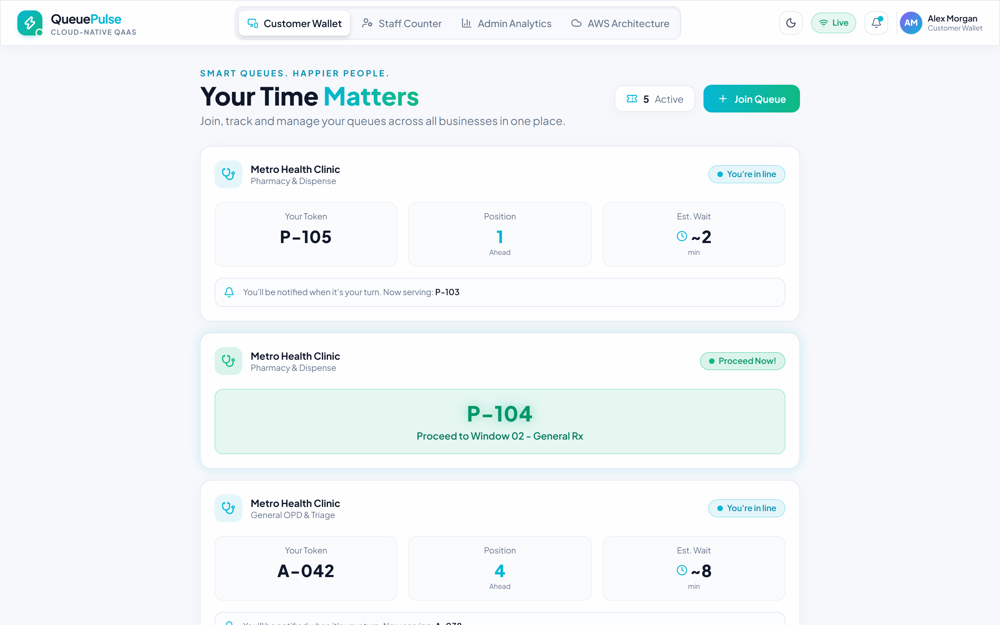
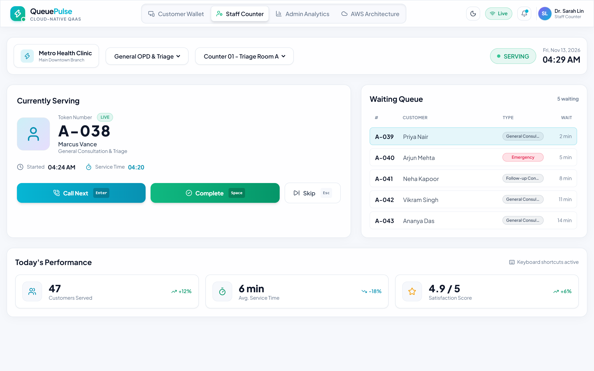
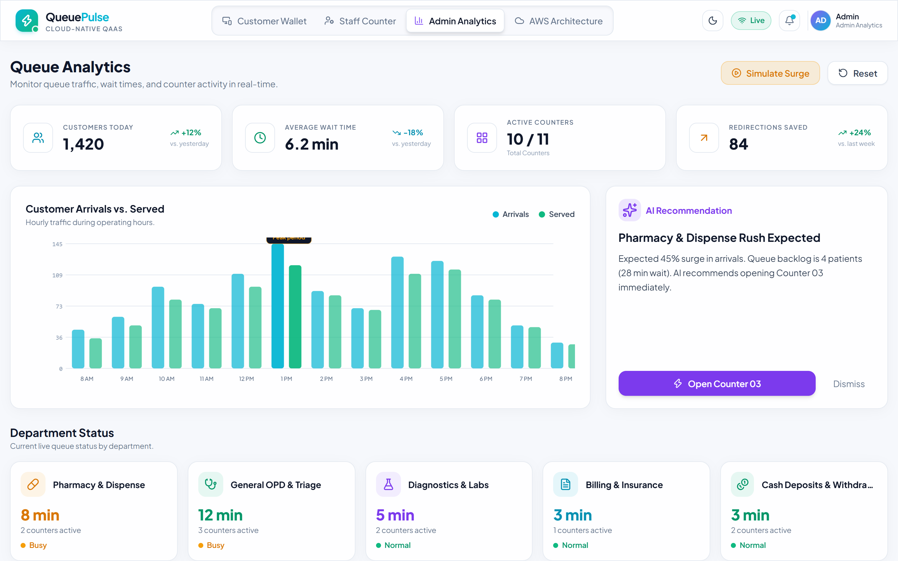
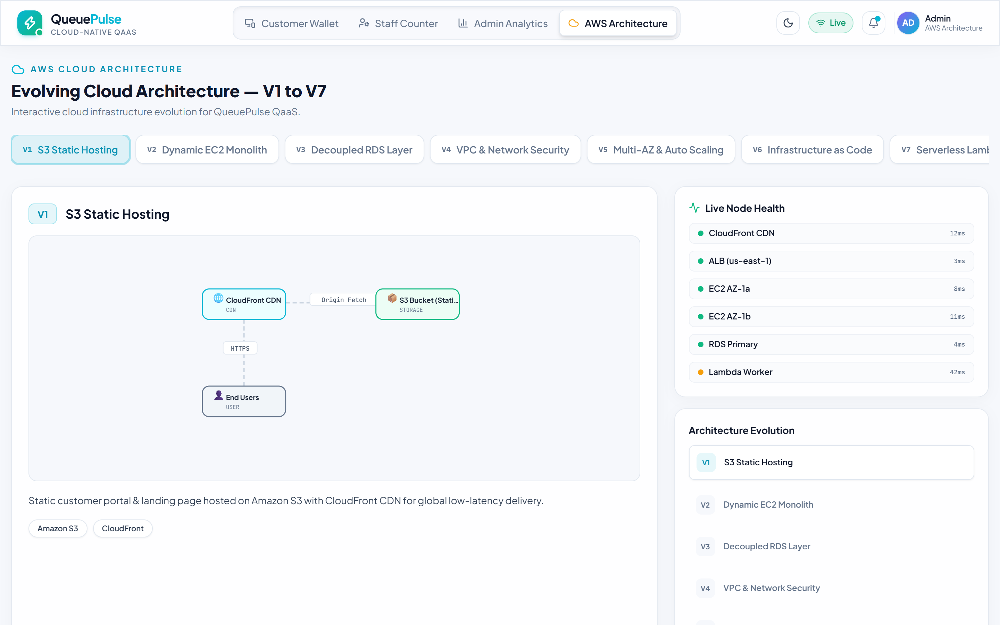
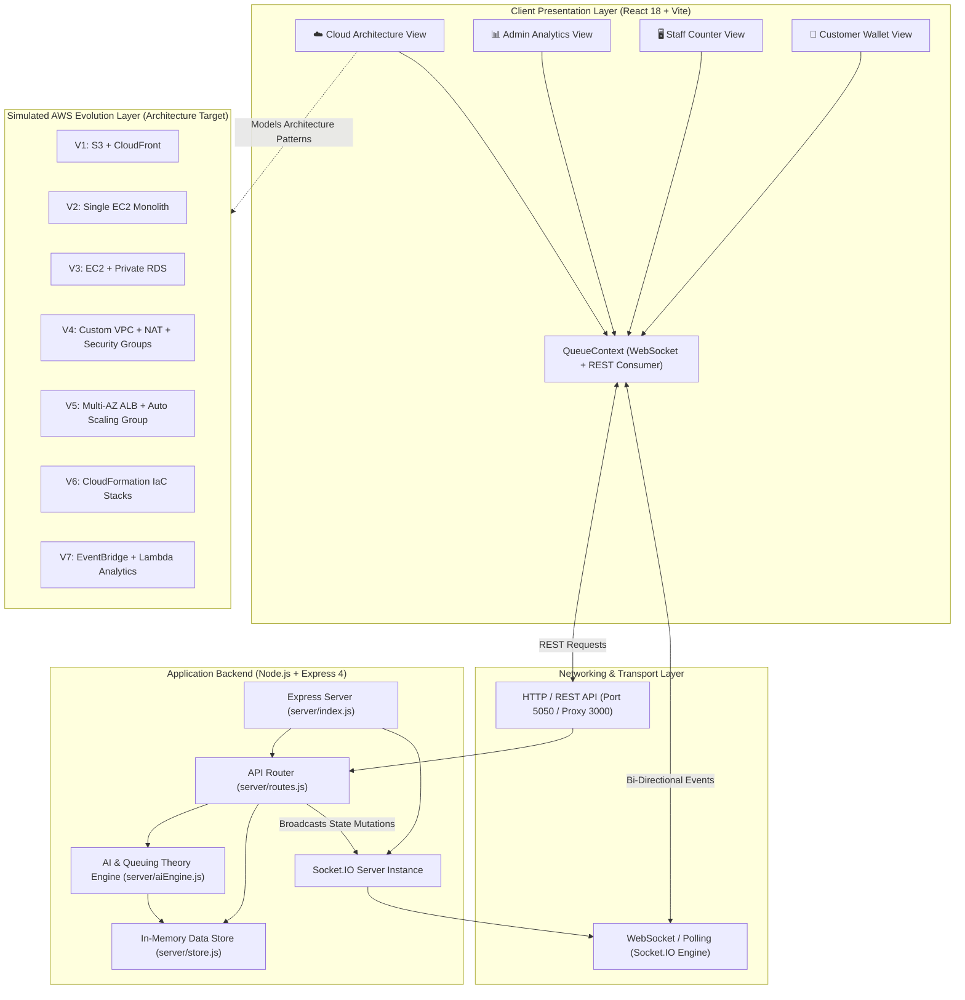
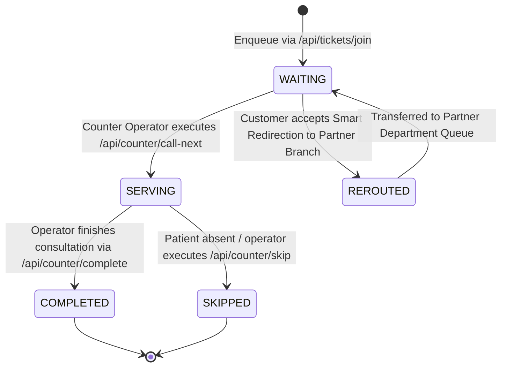

# QueuePulse — Queue-as-a-Service (QaaS) & Cloud Architecture

> A high-performance, real-time Queue-as-a-Service (QaaS) platform powered by Node.js, Express, Socket.IO, and React, featuring an analytical $M/M/c$ queuing theory and dynamic wait-time estimation engine, coupled with an interactive multi-stage AWS cloud infrastructure evolution simulator.

---

## 📌 Table of Contents
1. [Project Overview](#1-project-overview)
2. [Problem Statement & Proposed Solution](#2-problem-statement--proposed-solution)
3. [Key Features & User Roles](#3-key-features--user-roles)
4. [Screenshots & Application Walkthrough](#4-screenshots--application-walkthrough)
5. [System Architecture](#5-system-architecture)
6. [Real-Time Queue & Wait-Time Estimation Methodology](#6-real-time-queue--wait-time-estimation-methodology)
7. [Technology Stack](#7-technology-stack)
8. [Project Structure](#8-project-structure)
9. [Installation & Execution](#9-installation--execution)
10. [API & WebSocket Documentation](#10-api--websocket-documentation)
11. [AWS Cloud Architecture & Virtualization Lab Work](#11-aws-cloud-architecture--virtualization-lab-work)
12. [Limitations & Future Scope](#12-limitations--future-scope)
13. [Team & Contributions](#13-team--contributions)

---

## 1. Project Overview

**QueuePulse** is a full-stack, cloud-native Queue-as-a-Service (QaaS) platform engineered to replace disorganized physical waiting lines with an intelligent, synchronized digital queue management pipeline. Built as an academic Cloud Computing and Virtualization systems project, QueuePulse unifies customer self-service, staff counter throughput execution, administrative intelligence, and multi-tier cloud infrastructure design into a single reactive application.

The platform coordinates ticket state mutations in real time across distributed clients using persistent WebSockets (Socket.IO). Queue depths, counter assignments, and estimated wait times are continuously recomputed on the backend through an analytical multi-server queuing engine ($M/M/c$ model) and broadcast instantly to connected sessions. Alongside the live operational system, QueuePulse incorporates an interactive AWS Cloud Architecture Visualizer that models the step-by-step structural evolution of the application from an S3/CloudFront static tier to an auto-scaled, multi-Availability-Zone VPC deployment with serverless reporting.

---

## 2. Problem Statement & Proposed Solution

### The Problem
* **Unpredictable Physical Bottlenecks**: Traditional queuing in healthcare clinics, diagnostic centers, and service counters causes physical overcrowding, ambiguous wait times, and high customer anxiety.
* **Static, Unresponsive Counter Allocation**: Service counters frequently sit idle or become overburdened because administrators lack real-time arrival velocity metrics and proactive capacity alerts.
* **Siloed Branch Utilization**: When a primary facility experiences an arrival surge, neighboring affiliated branches often have excess capacity, but there is no automated mechanism to identify congestion and offer patients dynamic rerouting options.
* **Architectural Scalability Gaps**: Many existing queue management tools run on brittle on-premise hardware without clear migration pathways toward highly available, auto-scaled, and fault-tolerant cloud infrastructures.

### The Proposed Solution
* **Event-Driven Digital Queue Pipeline**: Issues digital tokens across multiple departments (General OPD, Pharmacy, Diagnostics, Billing) accessible directly from mobile and web browsers via a live Customer Wallet.
* **WebSocket-Driven State Synchronization**: Utilizes Socket.IO to guarantee sub-second bidirectional state replication across customer tickets, staff terminals, and executive dashboards without client polling.
* **Algorithmic Dynamic ETA & Surge Detection**: Employs an $M/M/c$ queuing theory formulation that factors in active counter capacity ($c$), service velocity ($\mu$), and arrival velocity ($\lambda$) to compute realistic wait times and recommend counter activation before SLA violations occur.
* **Smart Multi-Branch Cross-Redirection**: Automatically detects long wait times at saturated facilities and alerts the customer to alternative partner branches with shorter queue times and driving distance calculations.
* **Progressive Cloud Infrastructure Blueprint**: Implements a dedicated cloud topology simulator that benchmarks architectural trade-offs across storage, compute, security, multi-AZ resilience, Infrastructure-as-Code (IaC), and serverless reporting.

---

## 3. Key Features & User Roles

QueuePulse provides four specialized roles and operational perspectives, accessible via the top navigation switcher:

| Role / View | Core Audience | Primary Responsibilities & Implemented Capabilities |
| :--- | :--- | :--- |
| **📱 Customer Wallet View** | Patients & Clients | <ul><li>Real-time position tracking and live ahead-in-line counters.</li><li>Dynamic arrival-rate wait time estimates updated over WebSockets.</li><li>Status transitions (`WAITING` $\rightarrow$ `SERVING` $\rightarrow$ `COMPLETED`).</li><li>Smart Redirection banner when queue wait exceeds 10 minutes, with one-click rerouting to partner clinics.</li><li>Interactive modal to browse businesses and enqueue into specific service departments.</li></ul> |
| **🖥️ Staff Counter View** | Counter Operators & Doctors | <ul><li>Department and counter-specific consultation terminal.</li><li>Live consultation timer tracking active engagement duration (`startedAt` offset).</li><li>One-click actions: **Call Next** (`/counter/call-next`), **Complete** (`/counter/complete`), and **Skip** (`/counter/skip`).</li><li>Keyboard productivity shortcuts: `Enter` (Next), `Space` (Complete), `Escape` (Skip).</li><li>Counter status lifecycle transitions (`ONLINE`, `SERVING`, `OFFLINE`).</li></ul> |
| **📊 Admin Analytics View** | Operations Managers | <ul><li>Live system telemetry: active counters, waiting backlogs, average wait, and daily throughput.</li><li>Department-by-department utilization indicators, counter status breakdowns, and arrival rate curves.</li><li>AI crowd prediction alerts detecting impending rushes with a one-click **Open Counter** recommendation trigger.</li><li>Simulated arrival surge injector (`/api/demo/simulate-surge`) and factory reset mechanism (`/api/demo/reset`).</li></ul> |
| **☁️ Cloud Architecture View** | Cloud Engineers & Evaluators | <ul><li>Interactive topology visualizer spanning 7 architectural milestones (V1 to V7).</li><li>SVG node-link network rendering compute, storage, edge, and security layers.</li><li>Live execution simulation of AWS Lambda daily report generation (`/api/aws/lambda-report`) with simulated execution metadata (runtime, memory, duration, subnet).</li><li>Active AWS health check verification testing the target group `/health` endpoint.</li></ul> |

---

## 4. Screenshots & Application Walkthrough

The following screenshots capture the primary user roles and interfaces implemented in QueuePulse:

### 1. Customer Multi-Queue Wallet
The Customer Wallet displays active queue passes, current position in line, estimated wait times, and automated cross-branch redirection alerts during peak congestion.



*Key elements visible: Real-time token cards (`A-039`, `P-105`), dynamic countdown timers, ahead-of-you counters, and the Smart Redirection recommendation prompt.*

---

### 2. Staff Counter Operational Console
The Staff Counter view provides operators with queue control, active consultation timers, patient details, and rapid keyboard hotkeys for queue throughput.



*Key elements visible: Serving token overview, live consultation stopwatch, waiting queue preview, counter status switcher, and keyboard shortcut legends.*

---

### 3. Real-Time Admin Telemetry & AI Prediction Dashboard
The Admin Dashboard aggregates cross-department operations, queue depth metrics, proactive capacity warnings, and arrival velocity charts.



*Key elements visible: System SLA gauges, proactive AI capacity recommendations ("Open Counter 03"), simulated surge toggle, and department health cards.*

---

### 4. Interactive AWS Cloud Architecture Visualizer
The Cloud Architecture view simulates multi-stage AWS infrastructure evolution from static S3 hosting up to auto-scaled multi-AZ VPC deployments and Lambda serverless reporting.



*Key elements visible: Version selector (V1–V7), interactive network topology canvas, AWS service tags, and the live Lambda report execution trigger.*

---

## 5. System Architecture

QueuePulse follows an event-driven decoupled architecture. The React frontend interacts with the Node.js Express backend through REST endpoints for command dispatching and Socket.IO for real-time state broadcasts.



---

## 6. Real-Time Queue & Wait-Time Estimation Methodology

### 6.1. Ticket Lifecycle State Machine
Each customer ticket advances through deterministic state transitions managed inside [server/store.js](file:///c:/Users/noela/Desktop/Samuel%20Projects/ccl_queue_as_a_service/server/store.js):



* **`WAITING`**: The ticket is placed in the department's `waitingQueue`. Its position is computed relative to preceding active tokens.
* **`SERVING`**: When the counter operator calls the ticket, it is shifted into `servingTickets`, assigned to the specific `counterId`, and stamped with `startedAt = Date.now()`.
* **`COMPLETED`**: Consultation concludes. The counter returns to `ONLINE`, and department `completedToday` metrics increment.
* **`SKIPPED`**: The ticket is decommissioned from the serving array, returning the counter to idle availability.
* **`REROUTED`**: Congested tickets are extracted from the primary clinic and appended to the target branch queue, recalculating estimated wait times immediately.

---

### 6.2. Socket.IO Synchronization Pipeline
State synchronization avoids polling loops by using a broadcast-on-write event loop:

1. **Client Connection**: When a client initializes, the server handles `io.on('connection')` and emits `INITIAL_STATE`, containing all businesses, departments, counters, and queues.
2. **State Mutating Actions**: Any operational REST call (joining, calling, completing, skipping, rerouting, or opening a counter) executes synchronously against `queueStore`.
3. **Aggregated Metric Recalculation**: The backend triggers `broadcastSync(eventType)`, running aggregate throughput, counter utilization, and AI recommendations.
4. **WebSocket Broadcast**: The server emits `QUEUE_STATE_CHANGED` with the complete operational payload to every active socket connection across all roles.

---

### 6.3. Mathematical Wait-Time & Queuing Theory Formulation
QueuePulse implements dynamic wait-time estimation inside [server/aiEngine.js](file:///c:/Users/noela/Desktop/Samuel%20Projects/ccl_queue_as_a_service/server/aiEngine.js) derived from Kendall's $M/M/c$ multi-server queuing model:

#### 1. Input Parameters
* **$c$** = Number of active, functional counters in the department ($\max(1, \text{activeCounters})$).
* **$\mu$** = Service rate per counter in customers per hour:
  $$\mu = \frac{60}{\text{avgServiceTimeMinutes}}$$
* **$\lambda$** = Arrival rate velocity in customers per hour, approximated from the current queue backlog:
  $$\lambda = \left(N_{\text{waiting}} \times \frac{60}{15}\right) + 10$$

#### 2. Traffic Intensity / Utilization Factor ($\rho$)
$$\rho = \frac{\lambda}{c \cdot \mu}$$

#### 3. Average Wait-Time Calculation ($W_q$)
* **Congested / Saturated State ($\rho \ge 1.0$)**:
  When arrival velocity exceeds total counter processing capacity, the queue builds linearly. The estimated wait time is calculated as:
  $$W_q = \frac{(\lambda - c\mu) \cdot 60}{c\mu} + \frac{60}{\mu}$$
* **Stable State ($\rho < 1.0$)**:
  Using an Erlang-C queuing approximation, the probability of zero units in the system ($P_0$) and the expected queue length ($L_q$) are computed:
  $$P_0 = 1 - \rho$$
  $$L_q = \frac{(c \cdot \rho)^c}{c! \cdot (1 - \rho)^2} \cdot P_0$$
  $$W_q = \left(\frac{L_q}{\lambda} \cdot 60\right) + \frac{30}{\mu}$$

#### 4. Proactive Capacity Alerting
When $N_{\text{waiting}} \ge 4$ or $\rho > 0.85$, the AI engine flags the department as `isCongested` and generates an actionable recommendation (e.g., `Open Counter 03`) with projected time savings:
$$\text{Projected Savings} = \text{round}(W_q \times 0.6) \text{ minutes}$$

---

## 7. Technology Stack

| Layer | Technology | Version | Purpose in QueuePulse |
| :--- | :--- | :--- | :--- |
| **Frontend Framework** | React | `^18.3.1` | Single-Page Application (SPA) component hierarchy and state management |
| **Frontend Build Tool** | Vite | `^5.4.11` | Hot Module Replacement (HMR), dev server proxying, and production bundling |
| **Styling & Design** | Tailwind CSS | `^3.4.17` | Utility-first responsive styling with dual-theme glassmorphism |
| **Iconography & Effects** | Lucide React / Canvas Confetti | `^1.16.0` / `^1.9.4` | System icons and milestone completion animations |
| **Backend Runtime** | Node.js (ES Modules) | `>= 18.x` | Asynchronous JavaScript runtime environment |
| **Application Framework** | Express | `^4.21.2` | REST API routing, CORS handling, and health check endpoints |
| **Real-Time Communication** | Socket.IO / Client | `^4.8.1` | Bidirectional low-latency WebSocket synchronization |
| **Concurrency Runner** | Concurrently | `^9.1.2` | Parallel execution of backend and frontend in local development |
| **Cloud Simulation Target** | AWS Services (V1–V7) | N/A | S3, CloudFront, EC2, RDS PostgreSQL, VPC, ALB, ASG, CloudFormation, Lambda |

---

## 8. Project Structure

```
ccl_queue_as_a_service/
├── docs/                               # Project documentation and visual artifacts
│   └── screenshots/                    # Captured application walkthrough images
│       ├── 01_customer_wallet.png      # Customer Wallet and live ticket view
│       ├── 02_staff_counter.png        # Staff counter operational terminal
│       ├── 03_admin_analytics.png      # Admin telemetry and AI recommendation panel
│       └── 04_aws_cloud_architecture.png # Multi-tier AWS cloud architecture simulator
├── server/                             # Node.js Express backend application
│   ├── aiEngine.js                     # M/M/c queuing formulas, surge prediction, Lambda simulation
│   ├── index.js                        # Express server entry point, CORS, Socket.IO initialization
│   ├── routes.js                       # REST API route declarations and broadcast dispatchers
│   └── store.js                        # In-memory relational store, businesses, counters, ticket states
├── src/                                # React frontend application
│   ├── components/                     # Reusable interface components
│   │   └── Navbar.jsx                  # Header navigation, role switcher, theme toggle, connection status
│   ├── context/                        # React context providers
│   │   ├── QueueContext.jsx            # Socket.IO connection client, REST fetchers, state dispatcher
│   │   └── ThemeContext.jsx            # Dark / light mode state provider with persistent root classes
│   ├── views/                          # Primary role view modules
│   │   ├── AdminAnalyticsView.jsx      # Telemetry gauges, department heatmaps, AI recommendation triggers
│   │   ├── CloudArchitectureView.jsx   # Interactive AWS V1–V7 topology simulator and SVG graph renderer
│   │   ├── CustomerWalletView.jsx      # Mobile-first customer wallet, token passes, rerouting alerts
│   │   └── StaffCounterView.jsx        # Counter consultation terminal, elapsed timer, keyboard hotkeys
│   ├── App.jsx                         # Main application layout, view switching dispatcher
│   ├── index.css                       # Tailwind custom utility classes and design tokens
│   └── main.jsx                        # React virtual DOM entry point
├── index.html                          # HTML5 root template
├── package.json                        # Node.js project manifest, dependencies, and lifecycle scripts
├── postcss.config.js                   # PostCSS configuration for Tailwind CSS
├── tailwind.config.js                  # Tailwind design palette, extended brand tokens, theme definitions
└── vite.config.js                      # Vite server configuration, port bindings, and backend reverse proxy
```

---

## 9. Installation & Execution

### 9.1. Prerequisites
* **Node.js**: `v18.x` or later (tested on Node `v20.x` and `v24.x`)
* **npm**: `v9.x` or later

### 9.2. Installation Steps
1. Clone the repository:
   ```bash
   git clone https://github.com/samuelmichaelalva/ccl_queue_as_a_service.git
   cd ccl_queue_as_a_service
   ```
2. Install project dependencies:
   ```bash
   npm install
   ```

### 9.3. Running the Development Environment
Start both the backend server and frontend development environment simultaneously:
```bash
npm run dev
```

* **Frontend Client**: Accessible at `http://localhost:3000`
* **Backend API & WebSockets**: Running at `http://localhost:5050`
* **Vite Proxy Behavior**: Vite automatically proxies `/api` and `/socket.io` calls from port `3000` to port `5050` as configured in [vite.config.js](file:///c:/Users/noela/Desktop/Samuel%20Projects/ccl_queue_as_a_service/vite.config.js).

### 9.4. Production Build Verification
To test production compilation:
```bash
npm run build
```
This compiles the React application into optimized static assets in the `dist/` directory.

---

## 10. API & WebSocket Documentation

### 10.1. REST API Endpoints
All REST endpoints are served under `/api` (or directly for system endpoints):

| Method | Endpoint | Description | Request Body / Query Params | Response Summary |
| :--- | :--- | :--- | :--- | :--- |
| `GET` | `/health` | System health check (simulates AWS ALB target probe) | None | `{ status: "healthy", service: "...", az: "us-east-1a" }` |
| `GET` | `/api/state` | Returns complete business, department, and counter state | None | `{ businesses: [...], metrics: { ... } }` |
| `GET` | `/api/user-wallet` | Retrieves active queue passes for a given user | `?userId=guest_alex` | `{ tickets: [...] }` |
| `POST` | `/api/tickets/join` | Enqueues a customer into a specific department | `{ businessId, departmentId, customerName, serviceType, priority, userId }` | `{ success: true, ticket: { ... } }` |
| `POST` | `/api/counter/call-next` | Operator calls next waiting ticket to active counter | `{ businessId, departmentId, counterId }` | `{ success: true, servingTicket: { ... } }` |
| `POST` | `/api/counter/complete` | Marks the currently serving ticket as complete | `{ businessId, departmentId, counterId }` | `{ success: true, completedTicketId: "..." }` |
| `POST` | `/api/counter/skip` | Skips an absent or canceled ticket from the counter | `{ businessId, departmentId, counterId }` | `{ success: true, skippedTicketId: "..." }` |
| `POST` | `/api/ai/open-counter` | Executes AI recommendation to open an offline counter | `{ businessId, departmentId }` | `{ success: true, counter: { ... } }` |
| `POST` | `/api/ai/reroute-ticket` | Reroutes a customer ticket to an affiliated partner branch | `{ ticketId, targetBranchId }` | `{ success: true, newTicket: { ... } }` |
| `POST` | `/api/demo/simulate-surge`| Toggles simulated arrival burst in the OPD department | None | `{ success: true, isSurge: boolean }` |
| `POST` | `/api/demo/reset` | Resets the in-memory data store to initial state | None | `{ success: true, message: "..." }` |
| `POST` | `/api/aws/lambda-report` | Simulates an AWS Lambda serverless execution | None | `{ reportId, awsExecutionInfo: { ... }, summary: { ... } }` |

---

### 10.2. WebSocket Events (Socket.IO)

```
Client                                                  Server
  │                                                       │
  ├────── Socket Connection Handshake (ws://...) ────────>│
  │<───── 'INITIAL_STATE' (Full Business/Queue State) ────┤
  │                                                       │
  │─── POST /api/tickets/join (HTTP Request) ────────────>│
  │                                                       │
  │<───── 'QUEUE_STATE_CHANGED' (Broadcasted to ALL) ─────┤
  │       { type: 'TICKET_JOINED', businesses, metrics }  │
```

#### Inbound to Client
* **`INITIAL_STATE`**: Dispatched immediately upon WebSocket handshake.
  ```json
  {
    "businesses": [ /* full business array */ ],
    "timestamp": 1726315200000
  }
  ```
* **`QUEUE_STATE_CHANGED`**: Dispatched to all connected clients whenever any state mutation occurs.
  ```json
  {
    "type": "TICKET_CALLED",
    "businesses": [ /* updated state */ ],
    "metrics": {
      "customersToday": 54,
      "averageWaitMinutes": 6.2,
      "activeCounters": 6,
      "totalCounters": 9,
      "waitingCustomers": 11,
      "crossBusinessRedirections": 1,
      "aiRecommendation": { /* capacity suggestion */ },
      "hourlyArrivalStats": [ /* 12h history */ ],
      "isSimulatedSurge": false
    },
    "timestamp": 1726315215000
  }
  ```

---

## 11. AWS Cloud Architecture & Virtualization Lab Work

A core pillar of this academic repository is the systematic exploration of virtualization mechanisms and progressive AWS cloud architectures.

### 11.1. Local Implementation vs. Cloud Architecture Targets
To ensure accurate technical distinction:
* **Locally Implemented in Code**: Full Node.js/Express application, Socket.IO synchronization, in-memory queue store, $M/M/c$ estimation engine, interactive Cloud Architecture visualizer ([src/views/CloudArchitectureView.jsx](file:///c:/Users/noela/Desktop/Samuel%20Projects/ccl_queue_as_a_service/src/views/CloudArchitectureView.jsx)), mock ALB target health check endpoint (`/health`), and mock Lambda report execution generator (`/api/aws/lambda-report`).
* **Cloud Architecture Targets (Modeled V1–V7)**: Architectural specifications and evolution paths designed for progressive AWS deployment.

---

### 11.2. The 7-Stage AWS Cloud Evolution Model
The interactive visualizer models the step-by-step structural scaling of QueuePulse:

```
V1: S3 + CloudFront CDN       --> Static customer wallet and portal delivery with edge caching
V2: Dynamic EC2 Monolith      --> Node.js backend & embedded DB hosted on a single EC2 instance
V3: Decoupled RDS Layer       --> Compute moved to public subnet; PostgreSQL separated into private RDS
V4: Custom VPC & Networking   --> Custom CIDRs, NAT Gateways, Internet Gateways, Security Groups
V5: Multi-AZ Auto Scaling     --> Application Load Balancer (ALB) across 2 AZs with EC2 ASG + Multi-AZ RDS
V6: Infrastructure as Code    --> AWS CloudFormation templates parameterizing full multi-region stacks
V7: Serverless Event Analytics--> EventBridge cron schedules Lambda queries on RDS to generate S3 reports
```

---

### 11.3. Virtualization & Cloud Lab Milestones

```
┌─────────────────────────────────────────────────────────────────────────────┐
│                       LAB MILESTONES & PROGRESS                             │
├─────────────────────────────────────────────────────────────────────────────┤
│  ✅ Task 1: Type-2 Virtualization (VirtualBox & KVM)                         │
│  ✅ Task 2: Type-1 Bare-Metal Virtualization (Hyper-V)                       │
│  ✅ Task 3: AWS IAM (Identity & Access Management - Users, Groups & RBAC)   │
│  ⏳ Task 4: In Progress                                                     │
│  ⏳ Task 5: Upcoming                                                        │
│  ⏳ Task 6: Upcoming                                                        │
│  ⏳ Task 7: Upcoming                                                        │
│  ⏳ Task 8: Upcoming                                                        │
└─────────────────────────────────────────────────────────────────────────────┘
```

#### Task 1: Type-2 Hosted Virtualization (VirtualBox & KVM)
* **Objective**: Configure and evaluate virtual machines using hosted Type-2 hypervisors (Oracle VM VirtualBox) and Linux Kernel-based Virtual Machine (KVM).
* **Key Focus Areas**: Host OS vs. Guest OS boundaries, hardware abstraction layers, dynamic memory balloons, virtual disk allocation (VDI/qcow2), and virtual networking modes (NAT vs. Bridged).

#### Task 2: Type-1 Bare-Metal Virtualization (Hyper-V)
* **Objective**: Provision virtualized workloads directly atop hardware using Microsoft Hyper-V (Type-1 bare-metal hypervisor).
* **Key Focus Areas**: Microkernelized hypervisor architecture, Ring -1 privileged hardware execution, Virtual Switch Manager configuration (External, Internal, and Private switches), and dynamic memory management under load.

#### Task 3: AWS IAM — Identity & Access Management (PoLP & RBAC)
* **Objective**: Enforce and experimentally validate the **Principle of Least Privilege (PoLP)** and Role-Based Access Control (RBAC) across Amazon EC2 and Amazon S3 using IAM Users, User Groups, and Policy attachments.

##### RBAC Policy Matrix
| IAM User | Assigned Group | Attached Policy | Policy Type | Effective Permissions |
| :--- | :--- | :--- | :--- | :--- |
| `user-1` | **S3-Support** | `AmazonS3ReadOnlyAccess` | AWS Managed | Read-only access to Amazon S3 buckets and objects (`s3:Get*`, `s3:List*`). Denied all EC2 actions. |
| `user-2` | **EC2-Support** | `AmazonEC2ReadOnlyAccess` | AWS Managed | Read-only access to EC2 instances (`ec2:Describe*`, `cloudwatch:ListMetrics`). Denied start/stop actions and S3. |
| `user-3` | **EC2-Admin** | `EC2-Admin-Policy` | Inline Policy | Permissions to Describe, **Start**, and **Stop** EC2 instances (`ec2:StartInstances`, `ec2:StopInstances`). |

##### Empirical Verification Outcomes
1. **`user-1` (S3 Read-Only)**:
   * S3 Console verification: Successfully listed all buckets and downloaded objects.
   * EC2 Console verification: Navigation to Instances immediately yielded `UnauthorizedOperation` error.
2. **`user-2` (EC2 Read-Only)**:
   * EC2 Console verification: Successfully inspected instance IDs, public IPs, and CloudWatch CPU metrics.
   * Action restriction: Attempting `Stop Instance` triggered an explicit permission denial (`UnauthorizedOperation`).
   * S3 Console verification: Access denied on all bucket queries.
3. **`user-3` (EC2 Admin)**:
   * Execution verification: Successfully described and initiated state transition (`Stop Instance` executed cleanly, transitioning instance to `Stopping` $\rightarrow$ `Stopped`).

---

## 12. Limitations & Future Scope

### Current Limitations
1. **In-Memory Store Persistence**: The active queue state currently resides in Node.js heap memory (`queueStore`). While structured with PostgreSQL-compatible schemas, restarting the backend process resets the queue state.
2. **Single-Node Socket.IO Adapter**: WebSockets currently operate via the default in-memory adapter. Horizontal multi-instance scaling behind an ALB requires a distributed adapter (such as `@socket.io/redis-adapter`).
3. **Simulated Authentication**: User identities (`Alex Morgan`, `guest_alex`) are handled through mock sessions rather than an external identity provider (such as Amazon Cognito or JWT verification).

### Future Scope & Planned Enhancements
* **PostgreSQL & Prisma/TypeORM Integration**: Transition the data tier from in-memory arrays to persistent Amazon RDS PostgreSQL with connection pooling.
* **Redis Cache & Pub/Sub Layer**: Implement Amazon ElastiCache (Redis) to cache active queue depth metrics and distribute Socket.IO events across auto-scaled EC2 instances.
* **SMS & Push Notification Pipeline**: Integrate Amazon SNS (Simple Notification Service) to deliver automated SMS text alerts to patients when their token is within 2 positions of being called.
* **Production AWS Deployment**: Package the Node.js backend into an Amazon ECS (Fargate) containerized service behind an Application Load Balancer with SSL termination via AWS Certificate Manager (ACM).

---

## 13. Team & Contributions

This project was developed as a collaborative academic cloud computing and virtualization systems engineering initiative.

| Member | Primary Contributions & Responsibilities |
| :--- | :--- |
| **Samuel Michael Alva** | **Lead Architecture & Full-Stack Implementation**<br>• Designed and implemented the complete application codebase (React 18 frontend & Express/Node.js backend).<br>• Implemented real-time Socket.IO WebSocket synchronization, event dispatchers, and state broadcasting.<br>• Engineered the $M/M/c$ queuing theory intelligence engine and dynamic wait-time estimation formulas.<br>• Built all user interfaces: Customer Multi-Queue Wallet, Staff Consultation Console, Admin Analytics Dashboard, and interactive AWS Cloud Architecture Visualizer.<br>• Managed repository version control, commit history, and system build pipelines. |
| **Sidra Zulfikar Dingankar** | **Research, Specifications & Cloud Lab Work**<br>• Collaborated on queuing theory methodology research and healthcare queue optimization requirements.<br>• Assisted in defining role-based workflow specifications and multi-branch redirection parameters.<br>• Participated in execution, testing, and policy formulation for the Virtualization and AWS IAM lab series. |
| **Alan Joseph** | **Testing, Quality Assurance & Cloud Lab Work**<br>• Participated in manual testing across customer, staff, and admin workflows to validate state consistency.<br>• Assisted in empirical verification of AWS IAM permission boundaries and Type-1/Type-2 virtualization tasks.<br>• Contributed to documentation review, technical reporting, and system verification walkthroughs. |


